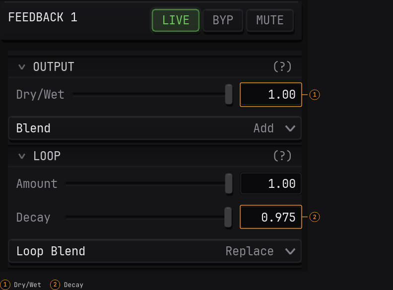

# Full documentation review, 22 October 2026

All **112 authored pages** in `src/content/docs/` were reviewed against the
repository's writing standard. Pages were revised where needed; an unchanged
page in the inventory was still read and reviewed. No existing page route was
removed. The pass also added the short audio-spectrum guide and guide index.

This record covers the whole-manual review following the illustrated beginner
and feedback milestone. It preserves review evidence for future documentation
work. [STYLE_GUIDE.md](../../../STYLE_GUIDE.md) owns the editing standard;
[AUTHORING.md](../../../AUTHORING.md) owns verification and capture procedures.
The [hex-docs skill](../../../.agents/skills/hex-docs/SKILL.md) is the entry
point for future work.

## Evidence and app identity

The source baseline was the released **v0.21.1** tag, peeled to commit
`c2427521416e4800277a59c2b869c41de2d193bc`. The published macOS release used for
captures and live procedures has executable SHA-256
`2aa295b93286e8a722e707db8567ffdbe3545d2fee6688e155ea0b2afd340191`.

The current release at review time was **v0.21.2**, commit
`32ad0fd6d582e5f204058d1bc802f60cf6623adb`. The source comparison identified
Windows stability, edit-command, and test changes. The UI labels and shaders
used by these captures are unchanged between those releases. The captures and
live checks remain identified as v0.21.1; the comparison does not constitute a
live v0.21.2 check.

The dirty app working checkout and later main contain a different mixture of
features. They were not used as the authority for released instructions.
Detailed source paths and line evidence appear in the reports below, relative
to the identified release snapshot.

| Review record | Scope |
|---|---|
| [Concepts](concepts.md) | All 13 concepts pages, with source evidence and retained behavior. |
| [Effects](effects.md) | All 56 FX pages and the Region reference; includes the 3 deliberately retained pages. |
| [Modules and modulation](modules-and-modulation.md) | All 22 module and modulation pages, followed by an independent read. |
| [Independent review](independent-review.md) | All 18 windows, shortcuts, troubleshooting, Getting Started, and guide pages as they stood during review. |

Those reports are snapshots of findings at review time. Their references to WIP
assets, concurrent checks, and proposed fixes do not describe the final status.
The resolutions and integrated validation status below take precedence.
Navigation pages are included in the complete inventory in this README.

## Resolved findings

The review changed explanations and reference entries where they obscured the
model or disagreed with released behavior:

- Chain order is left to right. Grouping nonadjacent modules can change their
  order against other modules and therefore the output. AUX sends copy the
  chain image after their host, including earlier images still visible there.
- Released control labels replaced stale names: LFO `LEVEL`, per-connection
  `Depth` and `Offset`, parameter-list `Clear All`, SOURCE/TEXT `Opacity`, and
  the actual SHAPE, noise, and Insert FX controls. Nonexistent SHAPE symmetry
  controls and the unsupported LFO one-shot description were removed.
- Luma Key's direction was corrected. Alpha behavior now distinguishes Add
  and Replace feedback from other loop blends, qualifies SCOPE and INSERT
  output by existing coverage, and explains empty chain areas without claiming
  that XOR reproduces an unchanged source image.
- LFO sync divisions are beats. A nondividing feedback `Hold` leaves a shorter
  final interval before the loop restarts. Operating limits, source-dependent
  controls, and useful failure conditions were retained.
- Export documentation uses the patch's `Song`, `Use song`, and separate
  `Video crossfade` and `Audio crossfade` controls. It distinguishes patch
  persistence from app settings, held external inputs from song analysis,
  and a File-source length cap from other source choices. The duplicate claim
  that exports carry no audio was removed.
- The AUX monitor includes POINTCLOUD readers. The Patches menu no longer
  advertises nonexistent `Save here`. Mixer lookup uses `INVERT B` and chroma
  `Tolerance`; its mode-specific controls are presented in a table.
- Getting Started links now lead to the promised gestures and snapshot
  instructions. Saving completion waits for the saved-file message;
  `Saving...` is conditional because short writes can finish before it appears.
- Routine save reminders and control outcomes that merely echoed their
  actions were cut. The audio guide omits an unreliable optional waveform
  seeking instruction. Optional exploration describes a useful control change
  without requiring exact-value experiments followed by undoing them.

All concrete findings in the independent root-scope review were addressed.
Literal UI casing suggestions and other minor editorial choices were assessed
alongside the final prose rather than treated as evidence of a new app test.

## What was verified

Keep these evidence types separate when describing this work.

### Source review

The full page inventory was read. Product corrections were checked against the
identified release snapshot, its parameter metadata, UI, rendering rules, and
input/file handling. An independent read covered the module/modulation edits
and the root-owned windows, shortcuts, troubleshooting, and walkthroughs.
Source inspection supports the documented model and labels; it does not
establish live device, hardware, or platform behavior.

The bare-number `Show as Time` behavior is source-checked: a number without a
unit is interpreted as seconds, including when the readout is in ms/min. A new
live check of that edge was not recorded. Explicit units remain the documented
way to enter durations unambiguously.

### Live macOS procedures and captures

The published v0.21.1 macOS app was operated for the illustrated procedures.
The evidence is in the [21 October capture manifest](../../captures/2026-10-21/manifest.json)
and [22 October capture manifest](../../captures/2026-10-22/manifest.json).
Both record the binary identity, original captures, crops, dimensions, hashes,
page usage, relevant settings, and checks actually performed.

- Beginner work: default layout, factory selection, numeric entry, saving and
  explicitly reopening the factory copy and animated kaleidoscope, and the
  released modulation picker flow.
- Feedback: opened the starting ring, added/configured feedback, saved and
  explicitly reopened the finished patch, and observed animation resume.
- Audio spectrum: opened the supplied patch, selected POINTCLOUD, loaded
  authored test audio through `File > Open Song...`, and observed the ring
  react while playback was running. `Space` playback and end-of-song restart
  were observed. The guide uses the reader's own audio; the test audio is not
  a published dependency. The app-saved copy retained its song reference after
  the strip was closed; that reference was removed from the portable starter
  JSON. The exact final starter was then opened through isolated startup
  restore and its ring observed. The final song-free fixture was not resaved
  through the app. The capture record distinguishes these checks.
- Recording: started/stopped a take and observed the app's completed-save
  message. Media inspection found H.264, 1920×1080, 30 fps, 323 frames and
  approximately 10.9 seconds; the full MP4 decoded successfully. These media
  checks are separate from the live recording controls and are not a claim
  that every recording/export configuration was exercised.

The general reference pass did not operate every control or test external
MIDI/CV hardware, NDI, Spout, or Syphon receivers. No new Windows/Linux live UI
checks were performed. No v0.21.2 live capture or complete live run of the whole
manual is claimed.

### Automated checks

The per-scope reports retain the checks run during editing, including route and
metadata checks on the then-current 110-page corpus, scoped diff/style checks,
and GFM table parsing for the FX reference. Earlier editor and offline preview
results belong to the preceding milestone. The final integrated results below
cover the 112-page corpus and screenshot markers after this review.

## Screenshot target markers

[The annotation registry](../../image-annotations.json) identifies 20 targets
across 11 UI screenshots. Four output/comparison images remain clean. The
renderer adds thin orange outlines, fixed-size numbered badges in external
gutters, and compact control-name legends using the site's graphite surfaces
and mono type. Original PNG pixels and their hashes are unchanged.

An independent review exercised the actual Astro Markdown processor for a
standalone feedback image and linked REC/song-strip images at the nested release
base. Each produced one figure and one clean-image anchor, without nested
anchors or a figure inside a paragraph. Target bounds are validated; the SVG
and visual badges are hidden from screen readers while alt text, the link, and
the numbered legend remain accessible.

Desktop and narrow-screen captures were visually inspected for the feedback
controls, REC, song strip, and spectrum controls. Outlines hit the intended
controls and badges do not cover screenshot pixels. Final integrated checks
are recorded below. The final review also removed long connectors crossing
neighboring values or toolbar controls and corrected the audio numeric-field
outlines. Connectors now span at most 24 published pixels.



## Final integrated validation

- **Source and renderer:** 17 production unit tests passed, covering the
  Markdown checker, asset handling, annotation bounds/identities, semantic
  figures, escaping, base paths, links, and short connectors. All 112 source
  pages passed metadata, route, image, patch, and annotation-usage checks.
  Production and versioned builds passed branding checks.
- **Contribution editor:** all 10 browser tests passed, including exact no-op
  preservation and edited semantic preservation for all 112 pages, image
  attributes, draft restore/review/submission, and mobile controls. The focused
  annotation/editor test passed again after the final connector/cache changes.
- **Service and archives:** 30 production service tests and the archive
  assembly fixture with two frozen manuals passed. Existing archives were not
  modified. The earlier milestone also completed a Wrangler deployment dry run;
  no deployment was performed.
- **Capture integrity:** both manifest regeneration checks passed for all 15
  published PNGs. The four example-patch hashes and unused-original hashes
  matched. The original audio generator reproduced the exact capture input.
- **Built routes:** all 112 content routes were crawled at 1440px and 320px
  with nonlocal requests blocked, for 224 page states, 14,042 rendered links,
  305 unique local route/fragment targets, and 19 tutorial assets. No broken
  target, image decode/alt failure, horizontal page overflow, console/page
  error, failed request, or external request was reported.
- **Annotated figures:** all 11 figures and 20 targets passed geometry checks
  at 1440px, 390px, and 320px, for 33 states. Image/SVG bounds align, badges
  remain outside screenshot pixels at a minimum 12px text size, and links
  retain accessible names. Final DOM checks confirmed the corrected audio
  fields and the 24-pixel connector limit. Root visually inspected the final
  LFO, workspace, feedback, audio, and REC figures.
- **Offline interactions:** local search and keyboard result navigation worked
  on desktop/mobile with nonlocal requests blocked. All four real patch
  downloads matched source bytes and parsed as JSON. Keyboard activation
  opened a clean full-size PNG; a direct nested reference reload worked.
- **Responsive reference:** 22 targeted states covered two-, three-, and
  four-column tables, the wordmark, mobile menu/search, and horizontal scrolling
  at 320/390/800/1024/1440px. Long Notes cells retain readable widths. Compact
  three-column tables and wider desktop rendering were preserved.
- **Final review:** maintainer-document links and `git diff --check` passed.
  No unresolved content or rendered-site finding remains from this pass.

The final manual-only preview was built with:

```sh
VIZARD_DOCS_PREVIEW=1 npm run build:release -- v0.21.2-docs-preview /hxc-docs/releases/v0.21.2-docs-preview/
```

It contains 115 generated HTML pages, including auxiliary routes, and 352
manifest files totaling **15,268,846 bytes**. All recorded file hashes matched.
Manifest SHA-256:
`284b52e5abe65c16c586c2dbfb7899bbd1cb3392c1a6e33f516f34c760fe646c`.

`localPreview` is true. `docsCommit` identifies base HEAD
`4f9e41f6abf4475c0f01eb90c9370b6d1a2df24a`; this was a build of uncommitted
working-tree changes, not a published revision. The local preview was served
at `http://127.0.0.1:47934/hxc-docs/releases/v0.21.2-docs-preview/`.

Browser QA used repository Playwright because no Browser-plugin tools were
available. Blocking nonlocal requests verifies dependency closure while the
manual's localhost server remains available. It does not establish installed
Help behavior.

No app package was built or verified for this review. Packaged Help behavior,
Windows/Linux UI procedures, and distribution/release publication remain
untested. No C++ compiler or app regression-test result is implied by the docs
build or browser checks. These checks were completed before committing or
pushing and do not establish deployment success. No app release or session-log
edit was performed.

## Complete page inventory

Paths are relative to `src/content/docs/`. Each listed page was reviewed;
editing was based on need, not a requirement to change every file. The inventory
was checked for 112 unique paths with no omissions or duplicates.

### Navigation (2)

- [index.md](../../../src/content/docs/index.md)
- [reference/index.md](../../../src/content/docs/reference/index.md)

### Getting Started (6)

- [getting-started/01-first-launch.md](../../../src/content/docs/getting-started/01-first-launch.md)
- [getting-started/02-load-a-factory-patch.md](../../../src/content/docs/getting-started/02-load-a-factory-patch.md)
- [getting-started/03-build-a-custom-chain.md](../../../src/content/docs/getting-started/03-build-a-custom-chain.md)
- [getting-started/04-record-and-output.md](../../../src/content/docs/getting-started/04-record-and-output.md)
- [getting-started/05-animate-your-pattern.md](../../../src/content/docs/getting-started/05-animate-your-pattern.md)
- [getting-started/index.md](../../../src/content/docs/getting-started/index.md)

### Guides (3)

- [guides/audio-spectrum.md](../../../src/content/docs/guides/audio-spectrum.md)
- [guides/feedback-trails.md](../../../src/content/docs/guides/feedback-trails.md)
- [guides/index.md](../../../src/content/docs/guides/index.md)

### Concepts (13)

- [concepts/aux-sends-and-buses.md](../../../src/content/docs/concepts/aux-sends-and-buses.md)
- [concepts/chain-groups.md](../../../src/content/docs/concepts/chain-groups.md)
- [concepts/docking-and-layout.md](../../../src/content/docs/concepts/docking-and-layout.md)
- [concepts/export-video.md](../../../src/content/docs/concepts/export-video.md)
- [concepts/index.md](../../../src/content/docs/concepts/index.md)
- [concepts/insert-fx-chains.md](../../../src/content/docs/concepts/insert-fx-chains.md)
- [concepts/midi-and-opensoundcontrol-learn.md](../../../src/content/docs/concepts/midi-and-opensoundcontrol-learn.md)
- [concepts/mixer-mode.md](../../../src/content/docs/concepts/mixer-mode.md)
- [concepts/modulation-matrix.md](../../../src/content/docs/concepts/modulation-matrix.md)
- [concepts/output-and-recording.md](../../../src/content/docs/concepts/output-and-recording.md)
- [concepts/patches-slots-and-banks.md](../../../src/content/docs/concepts/patches-slots-and-banks.md)
- [concepts/reading-the-panel.md](../../../src/content/docs/concepts/reading-the-panel.md)
- [concepts/signal-chain.md](../../../src/content/docs/concepts/signal-chain.md)

### Module reference (12)

- [reference/modules/feedback.md](../../../src/content/docs/reference/modules/feedback.md)
- [reference/modules/index.md](../../../src/content/docs/reference/modules/index.md)
- [reference/modules/insert.md](../../../src/content/docs/reference/modules/insert.md)
- [reference/modules/isf.md](../../../src/content/docs/reference/modules/isf.md)
- [reference/modules/noise.md](../../../src/content/docs/reference/modules/noise.md)
- [reference/modules/osc.md](../../../src/content/docs/reference/modules/osc.md)
- [reference/modules/pointcloud.md](../../../src/content/docs/reference/modules/pointcloud.md)
- [reference/modules/scope.md](../../../src/content/docs/reference/modules/scope.md)
- [reference/modules/shape.md](../../../src/content/docs/reference/modules/shape.md)
- [reference/modules/source.md](../../../src/content/docs/reference/modules/source.md)
- [reference/modules/sprite.md](../../../src/content/docs/reference/modules/sprite.md)
- [reference/modules/text.md](../../../src/content/docs/reference/modules/text.md)

### Modulation reference (10)

- [reference/modulation/audio-reactive.md](../../../src/content/docs/reference/modulation/audio-reactive.md)
- [reference/modulation/cv-gate.md](../../../src/content/docs/reference/modulation/cv-gate.md)
- [reference/modulation/envelope.md](../../../src/content/docs/reference/modulation/envelope.md)
- [reference/modulation/index.md](../../../src/content/docs/reference/modulation/index.md)
- [reference/modulation/lfo.md](../../../src/content/docs/reference/modulation/lfo.md)
- [reference/modulation/macro.md](../../../src/content/docs/reference/modulation/macro.md)
- [reference/modulation/midi-note.md](../../../src/content/docs/reference/modulation/midi-note.md)
- [reference/modulation/midi.md](../../../src/content/docs/reference/modulation/midi.md)
- [reference/modulation/opensoundcontrol.md](../../../src/content/docs/reference/modulation/opensoundcontrol.md)
- [reference/modulation/time.md](../../../src/content/docs/reference/modulation/time.md)

### Window reference (7)

- [reference/windows/aux-buses-monitor.md](../../../src/content/docs/reference/windows/aux-buses-monitor.md)
- [reference/windows/export-video.md](../../../src/content/docs/reference/windows/export-video.md)
- [reference/windows/index.md](../../../src/content/docs/reference/windows/index.md)
- [reference/windows/mixer-controls.md](../../../src/content/docs/reference/windows/mixer-controls.md)
- [reference/windows/mod-matrix.md](../../../src/content/docs/reference/windows/mod-matrix.md)
- [reference/windows/patches-bar.md](../../../src/content/docs/reference/windows/patches-bar.md)
- [reference/windows/settings.md](../../../src/content/docs/reference/windows/settings.md)

### Other reference and troubleshooting (3)

- [reference/insert-fx-region.md](../../../src/content/docs/reference/insert-fx-region.md)
- [reference/shortcuts.md](../../../src/content/docs/reference/shortcuts.md)
- [troubleshooting.md](../../../src/content/docs/troubleshooting.md)

### FX: blur (5)

- [reference/fx/blur/box-blur.md](../../../src/content/docs/reference/fx/blur/box-blur.md)
- [reference/fx/blur/gaussian-blur.md](../../../src/content/docs/reference/fx/blur/gaussian-blur.md)
- [reference/fx/blur/index.md](../../../src/content/docs/reference/fx/blur/index.md)
- [reference/fx/blur/motion-blur.md](../../../src/content/docs/reference/fx/blur/motion-blur.md)
- [reference/fx/blur/radial-blur.md](../../../src/content/docs/reference/fx/blur/radial-blur.md)

### FX: color (8)

- [reference/fx/color/black-white.md](../../../src/content/docs/reference/fx/color/black-white.md)
- [reference/fx/color/dither.md](../../../src/content/docs/reference/fx/color/dither.md)
- [reference/fx/color/hue-rotate.md](../../../src/content/docs/reference/fx/color/hue-rotate.md)
- [reference/fx/color/index.md](../../../src/content/docs/reference/fx/color/index.md)
- [reference/fx/color/invert.md](../../../src/content/docs/reference/fx/color/invert.md)
- [reference/fx/color/palette-map.md](../../../src/content/docs/reference/fx/color/palette-map.md)
- [reference/fx/color/posterize.md](../../../src/content/docs/reference/fx/color/posterize.md)
- [reference/fx/color/threshold.md](../../../src/content/docs/reference/fx/color/threshold.md)

### FX: crt (9)

- [reference/fx/crt/barrel.md](../../../src/content/docs/reference/fx/crt/barrel.md)
- [reference/fx/crt/convergence-error.md](../../../src/content/docs/reference/fx/crt/convergence-error.md)
- [reference/fx/crt/deflection-error.md](../../../src/content/docs/reference/fx/crt/deflection-error.md)
- [reference/fx/crt/glow.md](../../../src/content/docs/reference/fx/crt/glow.md)
- [reference/fx/crt/index.md](../../../src/content/docs/reference/fx/crt/index.md)
- [reference/fx/crt/persistence.md](../../../src/content/docs/reference/fx/crt/persistence.md)
- [reference/fx/crt/phosphor-mask.md](../../../src/content/docs/reference/fx/crt/phosphor-mask.md)
- [reference/fx/crt/scan-lines.md](../../../src/content/docs/reference/fx/crt/scan-lines.md)
- [reference/fx/crt/vignette.md](../../../src/content/docs/reference/fx/crt/vignette.md)

### FX: distort (4)

- [reference/fx/distort/index.md](../../../src/content/docs/reference/fx/distort/index.md)
- [reference/fx/distort/kaleidoscope.md](../../../src/content/docs/reference/fx/distort/kaleidoscope.md)
- [reference/fx/distort/transform.md](../../../src/content/docs/reference/fx/distort/transform.md)
- [reference/fx/distort/wave-warp.md](../../../src/content/docs/reference/fx/distort/wave-warp.md)

### FX: filter (5)

- [reference/fx/filter/edge-detect.md](../../../src/content/docs/reference/fx/filter/edge-detect.md)
- [reference/fx/filter/edge-enhance.md](../../../src/content/docs/reference/fx/filter/edge-enhance.md)
- [reference/fx/filter/index.md](../../../src/content/docs/reference/fx/filter/index.md)
- [reference/fx/filter/mask.md](../../../src/content/docs/reference/fx/filter/mask.md)
- [reference/fx/filter/pixelate.md](../../../src/content/docs/reference/fx/filter/pixelate.md)

### FX: grade (6)

- [reference/fx/grade/channel-attenuverter.md](../../../src/content/docs/reference/fx/grade/channel-attenuverter.md)
- [reference/fx/grade/channel-curves.md](../../../src/content/docs/reference/fx/grade/channel-curves.md)
- [reference/fx/grade/contrast.md](../../../src/content/docs/reference/fx/grade/contrast.md)
- [reference/fx/grade/index.md](../../../src/content/docs/reference/fx/grade/index.md)
- [reference/fx/grade/saturation-adjust.md](../../../src/content/docs/reference/fx/grade/saturation-adjust.md)
- [reference/fx/grade/white-balance.md](../../../src/content/docs/reference/fx/grade/white-balance.md)

### FX: key (10)

- [reference/fx/key/channel-select.md](../../../src/content/docs/reference/fx/key/channel-select.md)
- [reference/fx/key/chroma-key.md](../../../src/content/docs/reference/fx/key/chroma-key.md)
- [reference/fx/key/despill.md](../../../src/content/docs/reference/fx/key/despill.md)
- [reference/fx/key/dominant-channel.md](../../../src/content/docs/reference/fx/key/dominant-channel.md)
- [reference/fx/key/edge-key.md](../../../src/content/docs/reference/fx/key/edge-key.md)
- [reference/fx/key/index.md](../../../src/content/docs/reference/fx/key/index.md)
- [reference/fx/key/luma-key.md](../../../src/content/docs/reference/fx/key/luma-key.md)
- [reference/fx/key/luma-range.md](../../../src/content/docs/reference/fx/key/luma-range.md)
- [reference/fx/key/motion-key.md](../../../src/content/docs/reference/fx/key/motion-key.md)
- [reference/fx/key/sat-isolate.md](../../../src/content/docs/reference/fx/key/sat-isolate.md)

### FX: retro (4)

- [reference/fx/retro/grain.md](../../../src/content/docs/reference/fx/retro/grain.md)
- [reference/fx/retro/index.md](../../../src/content/docs/reference/fx/retro/index.md)
- [reference/fx/retro/rutt-etra.md](../../../src/content/docs/reference/fx/retro/rutt-etra.md)
- [reference/fx/retro/vhs.md](../../../src/content/docs/reference/fx/retro/vhs.md)

### FX: simulate (4)

- [reference/fx/simulate/fluid.md](../../../src/content/docs/reference/fx/simulate/fluid.md)
- [reference/fx/simulate/index.md](../../../src/content/docs/reference/fx/simulate/index.md)
- [reference/fx/simulate/reaction-diffusion.md](../../../src/content/docs/reference/fx/simulate/reaction-diffusion.md)
- [reference/fx/simulate/ripple.md](../../../src/content/docs/reference/fx/simulate/ripple.md)

### FX index (1)

- [reference/fx/index.md](../../../src/content/docs/reference/fx/index.md)
